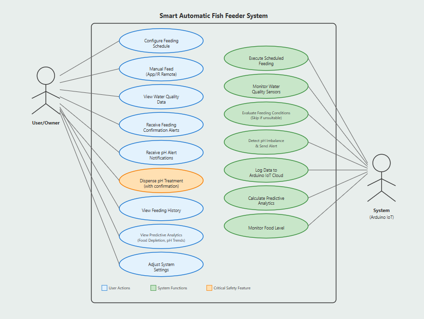

# Verivox-Showcase
Public showcase of a Smart Automatic Fish Feeder: Arduino IoT system with water quality monitoring, user-confirmed pH treatment, and cloud remote access.

## About the Project

Verivox is an IoT-enabled, Arduino-based aquarium system that combines automated feeding with real-time water quality monitoring. Unlike conventional feeders that dispense food on a fixed timer, this system checks the water first and skips feeding when conditions are unsuitable, so extra food never worsens an already poor environment.

It also includes a user-controlled pH treatment dispenser. The system alerts the user to a pH imbalance, but treatment is only dispensed after an explicit confirmation in the mobile app.

This project is developed as a Final Year Project (FYP) for the Bachelor of Computer Science with Honours (Software Engineering) at Universiti Malaysia Sarawak (UNIMAS).

## Why this project?

Reviewing three commercial products (EHEIM Automatic Feeding Unit, Neptune Systems APEX, and Hygger Smart WiFi Feeder) revealed several gaps:

No product connects feeding decisions to real-time water quality
Automated pH dosing (APEX) has no user confirmation, which creates an over-dosing risk
No convenient offline wireless control (e.g. IR remote) exists
Feeding alerts are absent or lack water quality context
Predictive analytics are missing in every reviewed product
Fully featured systems are expensive (RM 8,000+)
Project Status

## Key Features

The features below describe the designed system.

- 🍽️ **Scheduled feeding** with servo-based portion control
- 🧠 **Intelligent feeding control** that skips feeding when pH, turbidity, or TDS is unsuitable
- 🌡️ **Water quality monitoring** of pH, temperature, TDS, and turbidity
- 🔔 **pH alerts** as push notifications when pH leaves the safe range (6.5–8.5)
- 🧪 **User-confirmed pH treatment** where the peristaltic pump runs only after an explicit app confirmation
- 📲 **Remote access** via Arduino IoT Cloud and the Arduino IoT Remote app
- 📡 **IR remote backup** for offline local control when Wi-Fi is down
- ✅ **Detailed feeding confirmation alerts** that include a water quality snapshot
- 📈 **Predictive analytics** for food depletion forecasting and pH trend analysis
- 📦 **Food level detection** with an ultrasonic sensor
- 🖥️ **Local LCD display** for at-a-glance status
- 🗂️ **Event logging** of feeding, skips, alerts, and treatment events with an audit trail

## System Architecture
<p align="center">  </p>

The Arduino Nano 33 IoT acts as the central controller. It reads the sensors, runs the feeding decision logic, drives the actuators, and synchronises with Arduino IoT Cloud over Wi-Fi.

## Hardware Components

| Category | Component | Model / Specification | Purpose |
|----------|-----------|-----------------------|---------|
| **Microcontroller** | Arduino Nano 33 IoT | ABX00027, SAMD21 Cortex-M0+, WiFi NINA-W102, BLE 4.2 | Main controller with built-in Wi-Fi |
| **Sensors** | pH sensor module | DFRobot Gravity Analog pH Sensor V2 (SEN0161-V2), 0-14 pH, 5V | pH measurement |
| | pH probe | Lab-grade glass electrode, BNC connector, 1m cable | Water contact probe for pH sensor |
| | Temperature sensor | DS18B20, -55°C to +125°C, waterproof, 1m cable | Water temperature |
| | TDS sensor | DFRobot Gravity Analog TDS Sensor (SEN0244), 0-1000 ppm | Total dissolved solids |
| | Turbidity sensor | TS-300B, 0-1000 NTU, 5V, IR LED + photodetector | Water clarity |
| | Ultrasonic sensor | HC-SR04, 2-400 cm, 5V | Food level detection |
| **Actuators** | Servo motor | MGR996R, 11 kg/cm torque, 4.8-7.2V, metal gears | Food dispensing |
| | Peristaltic pump | 12V DC, 50-100 ml/min, 4x6mm tube | pH treatment dispensing |
| | Relay module | 1-channel 5V, 10A, optocoupler isolation | Pump switching |
| **User Interface** | LCD display | 2004 LCD with I2C adapter, 20x4 characters | Local status display |
| | IR receiver | TSOP1738, 38 kHz, 2.7-5.5V, NEC/RC5 | Offline remote control input |
| | IR remote | Universal NEC protocol remote, 10+ buttons | Offline manual control |
| | LEDs | 5mm Red, Green, Blue | Visual status indicators |
| | Buzzer | Active buzzer, 5V | Audible alerts |
| **Power** | Power adapter | 12V 2A DC, 5.5mm x 2.1mm plug | Main power supply |
| | Buck converter | LM2596 DC-DC module, 4-40V input, 3A max | Regulated 5V for Arduino and sensors |
| **Miscellaneous** | Pull-up resistor | 4.7kΩ, 1/4W | DS18B20 data line |
| | Breadboard | 830 full points | Prototyping |
| | Jumper wires | Male-male and male-female | Connections |
| | Level shifter | Unidirectional, 1 circuit | Voltage compatibility |
| | Silicone tubing | 4mm ID x 6mm OD | Pump tubing |
| | Cable glands | PG7 waterproof | Waterproofing |
| **Calibration Supplies** | pH buffer solutions | pH 4.0, 7.0, 10.0 (250 ml each) | pH sensor calibration |
| | TDS calibration solution | 1413 µS/cm | TDS sensor calibration |
| | pH storage solution | KCl storage solution | pH probe storage |
| | Distilled water | N/A | Sensor cleaning |

## Firmware
Arduino IDE (C/C++)
WiFiNINA, ArduinoIoTCloud, Arduino_ConnectionHandler
Servo, OneWire, DallasTemperature, LiquidCrystal_I2C, IRremote, NewPing

### Cloud and Mobile
Arduino IoT Cloud (data logging, dashboards, push notifications)
Arduino IoT Remote app (iOS and Android)

### Protocols
MQTT, HTTP/HTTPS, I2C, OneWire
Safety Design

### pH treatment is a safety-critical function. The design enforces human-in-the-loop control:
The system detects pH outside the safe range and sends a push notification.
The user reviews the current pH and water quality context in the app.
The user explicitly confirms the dispense action.
The pump activates, and the event is written to the audit log.

Treatment can never run without confirmation, and there is no scheduled or autonomous dosing.

## Design Documentation

### Use Case Diagram



### Class Diagram


### Sequence Diagrams

**Perform Automated Smart Feeding**


**Dispense pH Treatment**


### Mobile App Wireframes

**Dashboard**


**Feeding Schedule**


**pH Alert and Confirmation**


**Feeding Log and Trends**


## Development Methodology
The project follows the Waterfall model, chosen because hardware components and cloud infrastructure must be fully specified and procured before implementation, and because the safety-critical pH treatment feature needs careful verification at each stage.

Requirements gathering: a questionnaire survey of 25 aquarium hobbyists informed 20 functional and 15 non-functional requirements.

## Roadmap
Literature review of commercial systems
User requirements survey
Functional and non-functional requirements
UML design (use case, sequence, class diagrams)
System block diagram and app wireframes
Hardware assembly and sensor calibration
Firmware development
Arduino IoT Cloud and dashboard configuration
Intelligent feeding and pH alert logic
User-confirmed treatment dispensing
Predictive analytics
Testing and evaluation
Waterproof housing and final deployment

Possible future work: machine-learning-based feeding optimisation, multi-tank support, automated dosage calculation from tank volume, filter-status monitoring, and medication dispensing.

## Project Development

### Developer
Syajaratul Diana Binti A. Razak Bachelor of Computer Science with Honours (Software Engineering) Universiti Malaysia Sarawak (UNIMAS)

### Supervisors
Puan Eaqerzilla Phang 
Puan Seleviawati bt Tarmizi

##Repository Privacy Notice
This public showcase intentionally does not include:

Firmware source code
Cloud credentials, API keys, or device secrets
Wi-Fi configuration or authentication details
Unpublished or proprietary implementation details

This showcase is intended for:
Portfolio review
Recruitment evaluation
Project documentation
Development progress presentation

## Repository Structure

```
Verivox-Showcase/
├── README.md
├── LICENSE
├── assets/
│   ├── banner.png
│   ├── block-diagram.png
│   ├── use-case-diagram.png
│   └── class-diagram.png
├── screenshots/
│   ├── seq-smart-feeding.png
│   ├── seq-ph-treatment.png
│   ├── wireframe-dashboard.png
│   ├── wireframe-schedule.png
│   ├── wireframe-ph-alert.png
│   └── wireframe-logs.png
└── docs/
    └── FYP1_Paper.pdf
```

### Feedback
If you notice a documentation issue, broken link, or typo, or have professional feedback about this showcase, feel free to open an issue.
Please do not use public issues to request private source code, credentials, or other sensitive project data.

### Connect With Me
GitHub: @your-username
LinkedIn: Your Name
Email: syajaratuldianarazak@gmail.com

### License

Copyright © 2026 Syajaratul Diana Binti A. Razak. All rights reserved.

This repository is provided for portfolio, documentation, demonstration, and academic reference purposes only. Project source code remains private.
